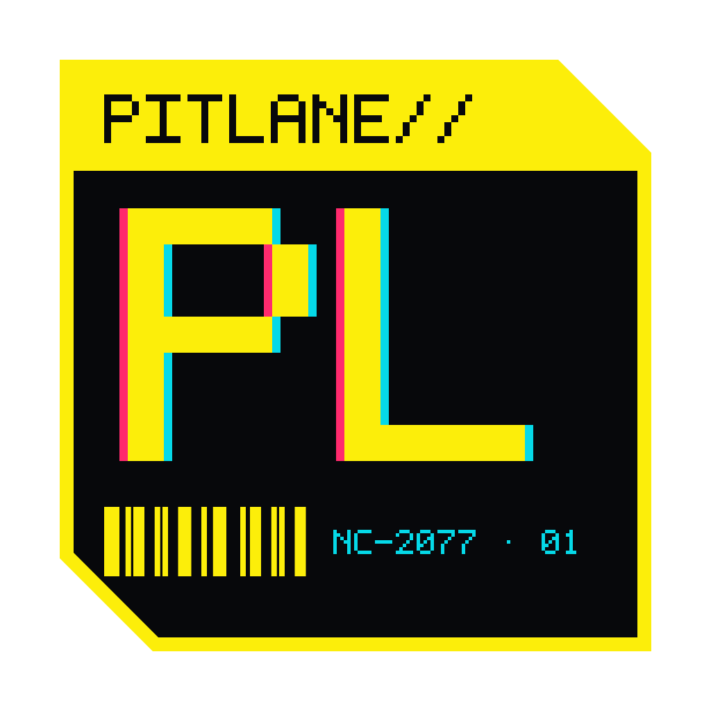

<p align="center"></p>

# Pitlane

**Your coding agents, one calm window per project.**

Pitlane watches your tracker for the tickets assigned to you, and a coding agent ([Claude Code](https://claude.com/claude-code) or Codex) writes a plan for each one. **No code is written until you start the work.** Then the agent works on its own branch in its own workspace, checks its own work, and opens the pull request. You watch it live, step in when it asks, and keep or revert its changes hunk by hunk.

It also reviews pull requests: the ones your teammates ask you to review, and your own. It writes each review as a draft, and **nothing is posted until you approve it.**

<p align="center"></p>

## What it does

- **Projects as tabs.** Every project is a tab at the top of the window: click one or press ⌘1–⌘9 to switch, `+` to add a folder. A tab shows `!2` when two things there wait on you. Agents keep running in the projects you are not looking at. The first screen is the sessions; anything waiting on you is at the top.
- **Live agent terminals.** Enter opens the agent's real terminal. Every key goes to the agent, Esc included. ⌘↑ goes home, ⌘K switches session.
- **Watches you control.** `w` opens them: add "Tickets assigned to me" (Jira or Linear through Claude's MCP tools, read-only) "Tickets I describe" (your own words for what to look for, such as *unassigned bugs labelled frontend*), or "PRs that need my review" (yours too, through `gh` or `glab`), narrow a watch to one project or team, change how often it checks and which model reads the tracker, run it now (`r` on home runs them all), switch it off, or remove it.
- **Plan first.** An assigned ticket gets a plan (understanding, approach, files, tests, risks) and waits for you. `s s` starts the work; `d d` throws the plan away.
- **Up next, in order.** What will start is numbered in the order it will start, and starts by itself when a workspace is free. Only tickets still in the tracker's To Do category queue themselves; ones already assigned when you switched a watch on, or already in progress or QA, are folded away under *Not started*. Enter puts one up next.
- **Its own branch, never a fresh clone.** Each project keeps a small pool of reusable workspaces (one per running agent, with no limit; a spare one is removed once its session ends). Your own checkout is never touched.
- **Self-review before every PR.** A review subagent reads the diff against the ticket, and the project's tests run, before anything is pushed.
- **Feedback loops back.** When a teammate requests changes or comments, inline or not, or CI fails on one of its PRs, the ticket goes back to the agent with the feedback. After three rounds a person is asked instead.
- **Live Changes.** ⌘D shows what the agent changed since it started. Keep or revert a file or a single hunk.
- **Five dark themes:** GitHub Dark (the default), Nord, Atom One Dark, Dracula and Tokyo Night. `t` cycles them.

| Watches you can edit | A review draft waits for you | Keep or revert what it changed |
|---|---|---|
|  |  |  |

| Nord | Atom One Dark | Dracula | Tokyo Night |
|---|---|---|---|
|  |  |  |  |

**Read more:** the [user guide](docs/guide.md) walks through every screen and key, and [how it works](docs/how-it-works.md) explains what runs where.

## Who it is for

Developers who already use Claude Code or Codex and want them working through the backlog while they do something else, without giving up control: you see every agent live, every change can be reverted, and nothing reaches a teammate until you say so.

## Install

Download the latest `.dmg` from [Releases](../../releases). Pitlane is macOS (Apple Silicon) only, signed and notarized, and updates itself from this repository's releases: you get a notification when a new version is ready, `U` restarts into it, and **Pitlane → Check for Updates…** checks by hand.

You need:
- [Claude Code](https://claude.com/claude-code) (or Codex), signed in;
- for tickets: a Jira or Linear MCP server added to Claude Code for the project;
- for pull requests: [`gh`](https://cli.github.com) or [`glab`](https://gitlab.com/gitlab-org/cli), signed in.

## Keys

| Where | Keys |
|---|---|
| Home | `enter` open · `n` new session · `w` watches · `r` run watches now · `a` show not-started tickets · `x` take a ticket out of up next · `s s` stop an agent · `C` clear ended sessions · `c` changes · `p` open PR · `x x` park a held session · `X` delete a session · `t` theme · `U` update · `?` help |
| Watches | `a` add · `e` edit (`↑↓` field, `←→` change) · `space` on/off · `r` run now · `R` run all · `x x` remove · `esc` back |
| Session | everything goes to the agent · `⌘↑` home · `⌘K` switcher · `⌥⌘←/→` prev/next · `⌘D` changes |
| Changes | `k` keep · `r` revert · `R` revert hunk · `K` keep all · `X X` revert all · `esc` back |
| Review draft | `a a` approve & post · `e` edit · `v` verdict · `x` drop comment · `d d` discard |

## How it keeps your work safe

Read [SECURITY.md](SECURITY.md) before letting it run unattended. In short:

- **Your checkout is never touched.** Agents work in separate git worktrees under `~/Library/Application Support/Pitlane/workspaces/`.
- **Nothing is thrown away.** A workspace left with unfinished work is held until you park it, which commits the work locally.
- **Tracker polling is read-only.** Every tool except the tracker's audited read-only ones is refused.
- **Reviews of other people's code run without your tokens,** and their drafts are posted only after you approve them, twice.

## Build from source

```sh
npm install
npm run dev              # vite + electron
npm test                 # unit tests
npm run smoke            # builds, then drives the real app with a fake agent
node tests/m2-smoke.mjs  # workspaces and Changes (after a build)
node tests/m3-smoke.mjs  # watches, up next, the lead agent and PRs
node tests/m4-smoke.mjs  # teammate reviews and feedback on its own PRs
npm run dist:unsigned && node tests/packaged-smoke.mjs   # the packaged app
```

A signed release (`npm run dist:release`) reads the Apple notarisation values from a gitignored `.env`. Without `PITLANE_UPDATE_URL` it updates from this repository's GitHub releases.

## Licence

[Apache-2.0](LICENSE)
