# Pitlane user guide

Pitlane is a macOS app that runs coding agents for you, one window per project. You can drive the agents yourself, or let Pitlane pick up work on its own: tickets assigned to you in Jira or Linear, and pull requests your teammates ask you to review. Every agent works in its own workspace on its own branch. Nothing it does touches your checkout, and nothing goes to a teammate without your approval.

This guide follows the order you meet things in.

- [1. First launch](#1-first-launch)
- [2. The home screen](#2-the-home-screen)
- [3. Sessions](#3-sessions)
- [4. Workspaces](#4-workspaces)
- [5. Watches](#5-watches)
- [6. How a ticket gets done](#6-how-a-ticket-gets-done)
- [7. Reviewing teammates' pull requests](#7-reviewing-teammates-pull-requests)
- [8. Live Changes](#8-live-changes)
- [9. Themes](#9-themes)
- [10. All keys](#10-all-keys)
- [11. Troubleshooting](#11-troubleshooting)

---

## 1. First launch

Pitlane opens on a project picker. Choose **Open folder…** and pick a git repository. The project gets its own window, and an entry in the Dock menu so you can open it directly next time. Open as many projects as you like; each one is a separate window with its own agents.

What you need installed:

| For | You need |
|---|---|
| Any agent | [Claude Code](https://claude.com/claude-code) (`claude`) or Codex (`codex`) on your `PATH`, signed in |
| Ticket watches | A Jira (Atlassian) or Linear MCP server added to Claude Code, globally or for the project |
| Pull requests | [`gh`](https://cli.github.com) (GitHub) or [`glab`](https://gitlab.com/gitlab-org/cli) (GitLab), signed in |

Pitlane uses the project's own GitHub or GitLab account, read from `gh`/`glab`, and hands it to agents per command. It never switches the account your other terminals use.

## 2. The home screen

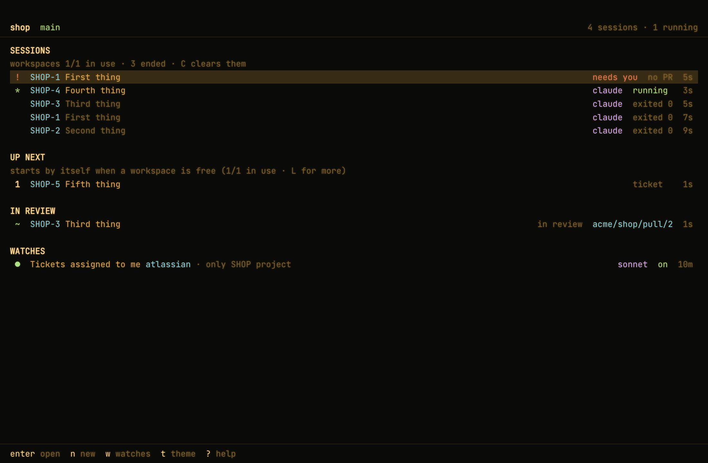

Everything about a project is on one screen, top to bottom:

1. **Needs you** (marked `!`): a ticket whose agent asked a question or stopped without a PR, and review drafts waiting for your approval. These are always at the top.
2. **Sessions**: every agent session, running first. Each row shows the ticket (if any), the agent, its state and its age. The line above says how many workspaces are in use, and how many sessions have ended (`C` clears those).
3. **Up next**: tickets and reviews that will start by themselves, numbered in the order they will start. The line above says whether one is starting now or waiting for a workspace.
4. **Not started**: tickets that were already assigned to you when you switched a watch on, plus review requests from people outside the repository's team. Pitlane never starts these by itself. They are folded into one line until you press `a`.
5. **In review**: tickets whose pull request is open, with a link to it (`p` opens it).
6. **Watches**: a summary of what Pitlane is watching. `w` opens the watch editor.

One cursor (`j`/`k` or the arrows) moves over every row on the screen, and `enter` does the obvious thing for the row it is on: opens a session, starts a ticket, opens a review draft or a pull request.

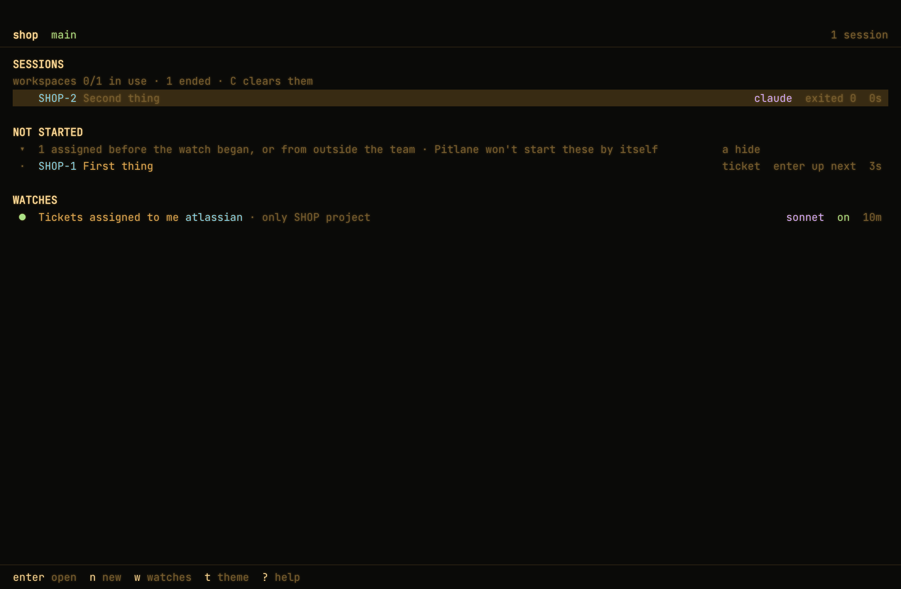

## 3. Sessions

Press `n` to start a session yourself and pick Claude or Codex. Pitlane opens the agent's **real terminal**: every key you type goes to the agent, including Esc (which interrupts Claude). Pitlane only keeps a few ⌘ shortcuts:

| Key | Does |
|---|---|
| `⌘↑` | back to the home screen; the agent keeps running |
| `⌘K` | the session switcher: type to filter, Enter to switch |
| `⌥⌘←` / `⌥⌘→` | previous / next session |
| `⌘D` | what this agent has changed (see [Live Changes](#8-live-changes)) |

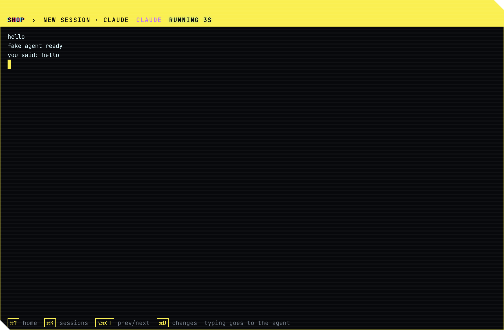

Closing a window never stops its agents. Reopen the project and they are still there, with what they printed while you were away.

On the home screen:

- `s s` stops the selected session's agent. Its workspace and changes are kept. If it was working on a ticket, the ticket waits for you under *needs you*.
- `C` clears ended sessions from the list. A session whose workspace still holds unsaved work stays until you park it.

When an agent asks something (Claude's notification hook), its row is marked `!`, it moves to the top, and macOS shows a notification. Typing an answer clears the mark.

## 4. Workspaces

Agents never run in your checkout. Each project has a small pool of **reusable workspaces**: git worktrees under `~/Library/Application Support/Pitlane/workspaces/`. A session switches a free workspace to its branch instead of cloning the project again, so there is no pile-up of copies.

- **How many agents at once:** `L` cycles 1, 2 or 3 per project (the default is 1). Across all projects at most three unattended agents run at a time.
- **Local files:** the first time you start an agent, Pitlane lists the git-ignored files at the project root (`.env`, `*.local.*`) and asks which to copy into workspaces. They are copied, never linked, and copied again only when your original changes.
- **Dependencies** are installed in a workspace when its lockfile changes.
- **Held workspaces:** when an agent ends with uncommitted work, its workspace is *held* rather than wiped, so nothing is lost. `x x` on that session *parks* it: the work is committed locally on its branch and the workspace is freed.

## 5. Watches

A watch checks for new work on its own and starts it. Press `w` on the home screen to open the watches.

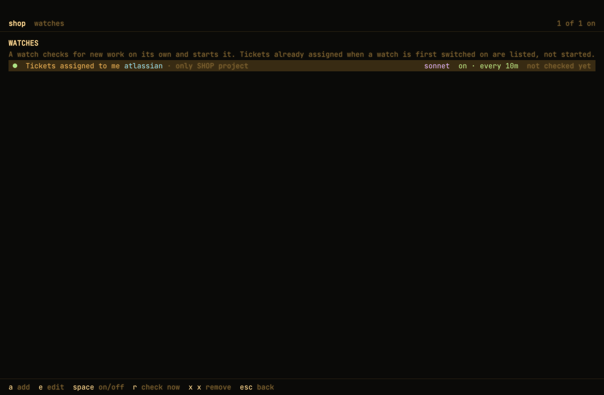

There are two kinds:

| Watch | Looks at | How |
|---|---|---|
| **Tickets assigned to me** | Jira or Linear | Asks Claude (Sonnet by default) to list your open tickets through the tracker's MCP server, **read-only**: every tool except the tracker's audited read-only ones is refused |
| **PRs that need my review** | GitHub or GitLab | `gh search prs --review-requested=@me` or `glab mr list --reviewer=@me` |

On the watches screen:

| Key | Does |
|---|---|
| `a` | add a watch: one per tracker server Claude knows for this project, and the review watch |
| `e` / `enter` | edit the selected watch |
| `space` | switch it on or off |
| `r` | check now instead of waiting for the interval |
| `x x` | remove it (what it already found stays on the home screen) |
| `esc` | back home |

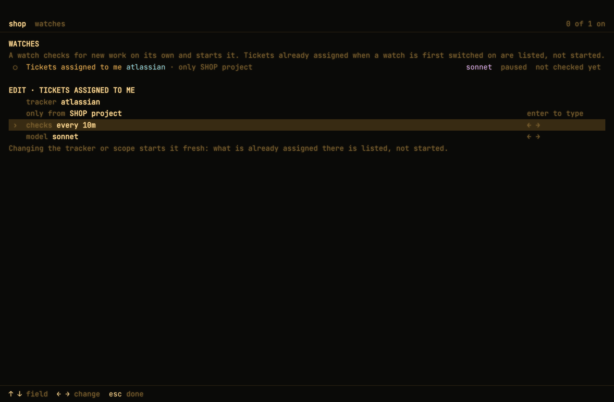

When editing (`↑↓` moves between fields, `←→` changes one):

- **tracker**: which Jira or Linear server to read, if Claude has more than one.
- **only from**: narrow the watch to one Jira project, Linear team or site, such as `SHOP project`. Useful when one account reaches several companies' work.
- **checks**: every 5, 10, 30 or 60 minutes.
- **model**: Sonnet, Haiku or Opus for reading the tracker.

**The first check only takes note.** When a watch is switched on for the first time, or after you change its tracker or scope, whatever is already assigned to you goes under *Not started* instead of starting: switching a watch on never starts ten agents at once. From then on, a ticket newly assigned to you goes to *Up next* and starts when a workspace is free. Press `a` on the home screen to see the not-started tickets, and `enter` on one to put it up next. `x` on an Up next ticket takes it back out.

## 6. How a ticket gets done

When a ticket starts, the project's lead agent (Claude by default) gets the ticket's full text, read from the tracker word for word and fenced as data, not instructions. It works on its own branch:

- named after the ticket, like `shop-12-fix-the-cart`, cut from your trunk and not tracking it;
- or, if a branch for the ticket key already exists on the remote, that branch, continued.

The workflow it is given:

1. Read the code and plan, using subagents for research when it helps.
2. Implement, following the project's conventions and its `CLAUDE.md` or `AGENTS.md`.
3. Run the tests, typecheck and lint, and fix what fails.
4. **Self-review:** a review subagent reads the diff against the ticket for bugs, missed requirements and leftover debugging, and the agent fixes what it finds.
5. Commit, push its branch, and open a pull request (or update the existing one).

Then Pitlane follows the pull request:

- **Opened**: the ticket moves to *In review* and the workspace is handed back.
- **Merged or closed**: the ticket is done.
- **Changes requested, new comments (inline or not), or failing CI**: the ticket goes back to *Up next*, ahead of new tickets, and the agent gets the feedback with the same branch. Only feedback from the repository's owners, members and collaborators counts, never from bots or passers-by. After three rounds on the same pull request, a person is asked instead.
- **The agent stopped without a PR, or asked something**: the ticket is marked *needs you*, with the reason.
- **Unassigned from you**: marked *needs you*, and never started again on its own.

If Claude reports a usage limit, Pitlane pauses starting new work until the limit resets, and says so on the home screen.

## 7. Reviewing teammates' pull requests

With the review watch on, a pull request that asks for your review is reviewed **before** new tickets. The review agent checks out the PR in a detached workspace and writes a draft review: a summary, a verdict (approve, comment or request changes), and comments on specific lines.

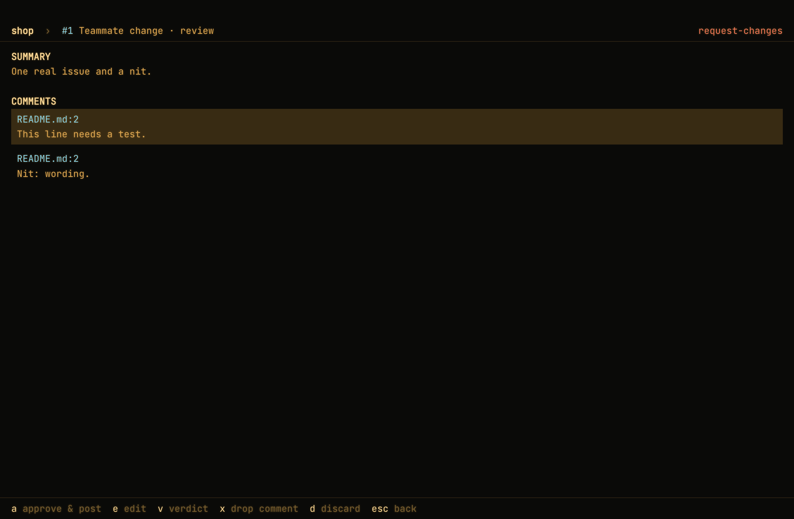

The draft appears at the top of the home screen as *review ready*. Open it with `enter`:

| Key | Does |
|---|---|
| `e` | edit the summary (`⌘↵` saves) |
| `v` | change the verdict |
| `x` | drop the comment under the cursor |
| `a a` | approve and post: press twice |
| `d d` | discard the draft |

**Nothing is posted until you press `a` twice.** Pitlane posts it, not the agent, and the review agent runs without your GitHub or GitLab token in the first place. A PR from someone outside the team is listed under *Not started* rather than reviewed by itself.

## 8. Live Changes

`⌘D` in a session, or `c` on the home screen, shows everything the agent has changed since it started, updated live.

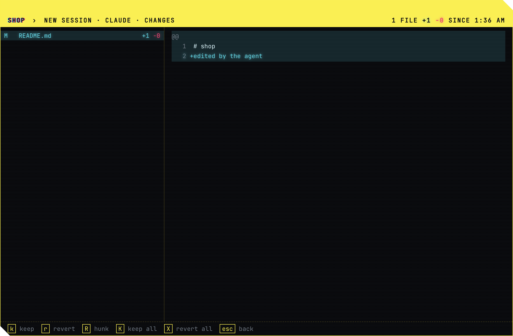

| Key | Does |
|---|---|
| `j` / `↑↓` | next / previous file |
| `J` / `←→` | next / previous hunk |
| `k` | keep this file |
| `r` | revert this file |
| `R` | revert this hunk |
| `K` | keep everything |
| `X X` | revert everything |
| `esc` | back |

## 9. Themes

`t` cycles the project's theme; each project remembers its own. The agents' 16 terminal colours are mapped into each theme, so their output stays readable.

| | |
|---|---|
|  **VT220**: amber phosphor | 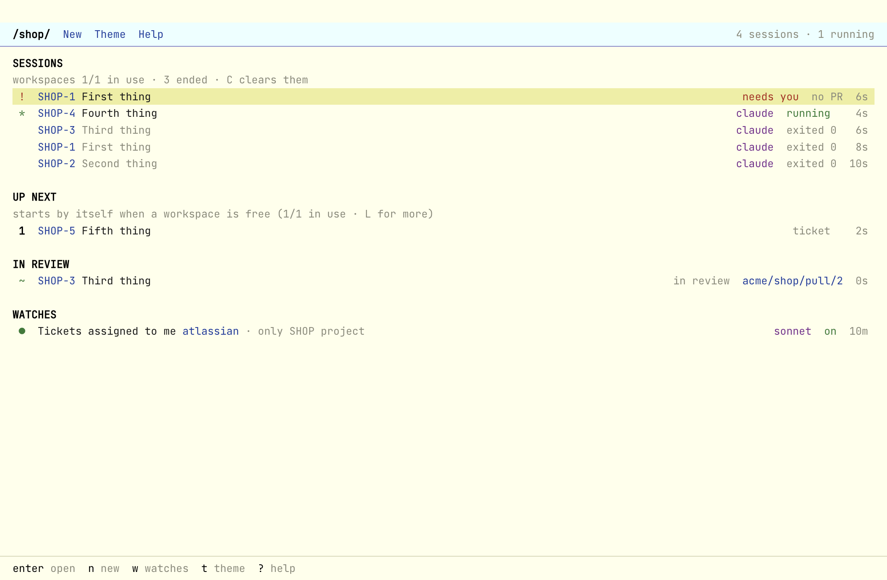 **Acme**: pale paper, commands in a tag line you click |
| 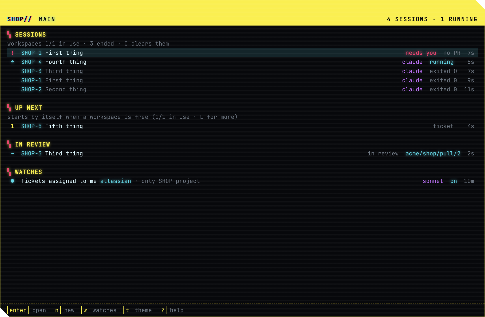 **Night City**: neon yellow, cut corners, scanlines | 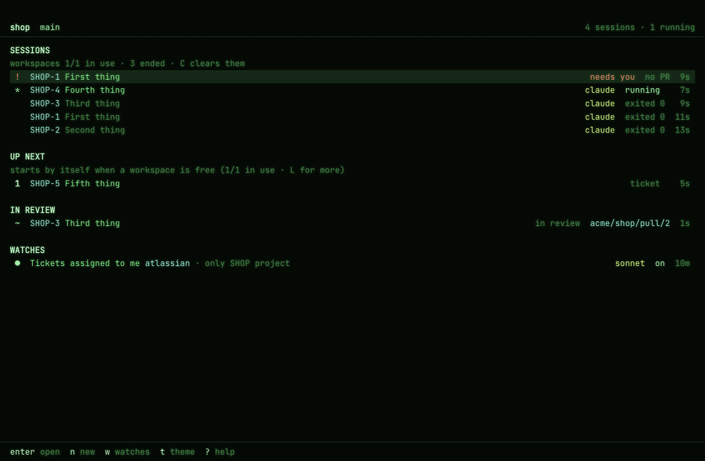 **Green Screen**: green phosphor and faint scanlines |
| 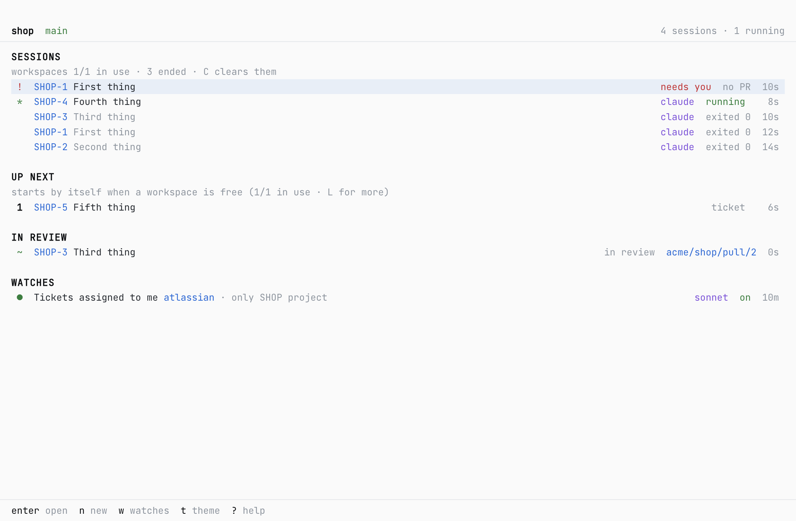 **Daylight**: a plain light theme | 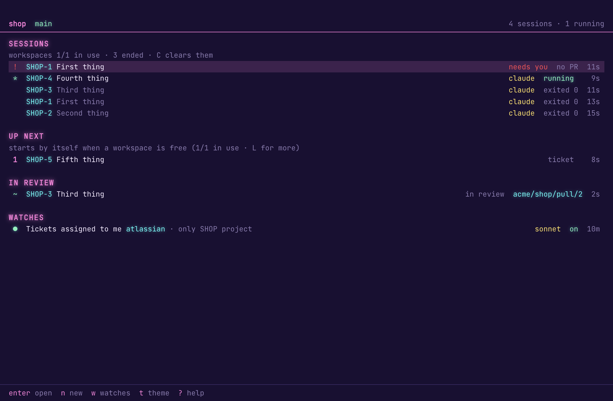 **Synthwave**: violet with neon headings |
| 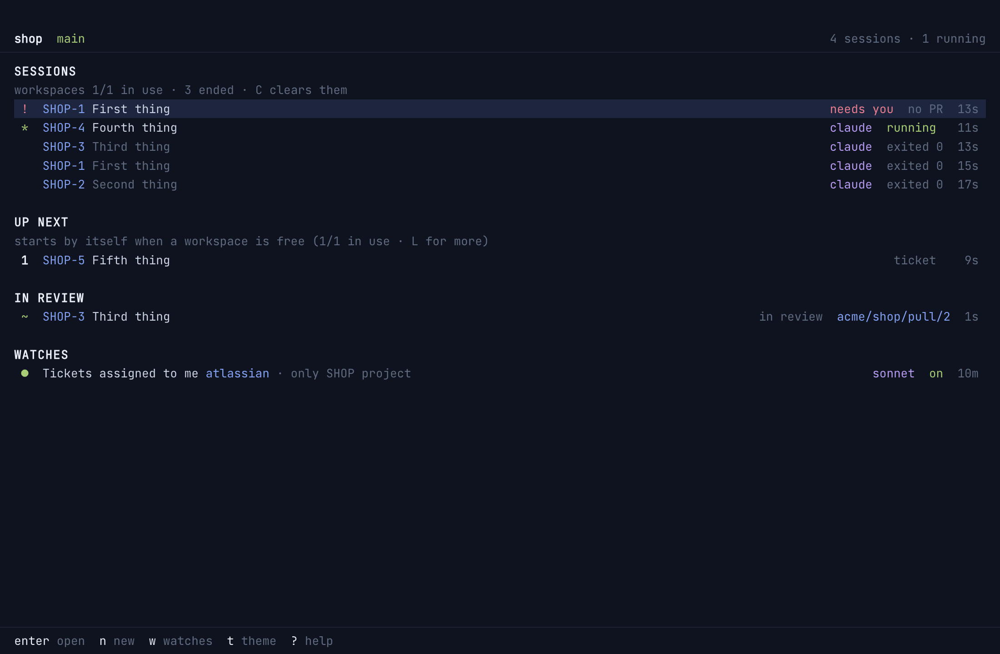 **Midnight**: a quiet dark blue | |

## 10. All keys

| Where | Keys |
|---|---|
| Home | `enter` open · `n` new session · `w` watches · `a` show/hide not started · `x` take out of up next · `s s` stop agent · `C` clear ended · `c` changes · `p` open PR · `x x` park held session · `L` agents at once · `t` theme · `?` help · `⌘K` switcher |
| Watches | `a` add · `e` edit · `space` on/off · `r` check now · `x x` remove · `esc` back |
| Session | everything goes to the agent · `⌘↑` home · `⌘K` switcher · `⌥⌘←/→` prev/next · `⌘D` changes |
| Changes | `k` keep · `r` revert · `R` revert hunk · `K` keep all · `X X` revert all · `j`/`J` files/hunks · `esc` back |
| Review draft | `a a` approve & post · `e` edit · `v` verdict · `x` drop comment · `d d` discard · `esc` back |

## 11. Troubleshooting

- **The ticket watch says "no Jira or Linear MCP server for this project".** Add the Atlassian or Linear MCP server to Claude Code (`claude mcp add …`), for the project or globally, and sign in to it once in a normal `claude` session.
- **A watch shows `error`.** The message is under the watch. `r` checks again. A tracker that answers with prose instead of a list is treated as an error, never as "nothing assigned".
- **"no GitHub login" on a session.** The project's account is not signed in to `gh`. Run `gh auth login` for it; the agent still runs, but cannot push.
- **The folder moved.** The window offers *Locate…*; pick the new folder and everything (sessions, workspaces, Claude's MCP servers) follows it.
- **An update is ready.** The status line says so; it installs the next time you quit.
