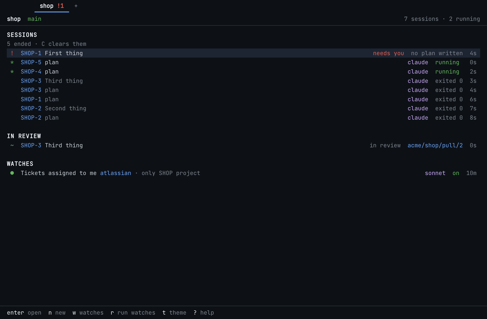
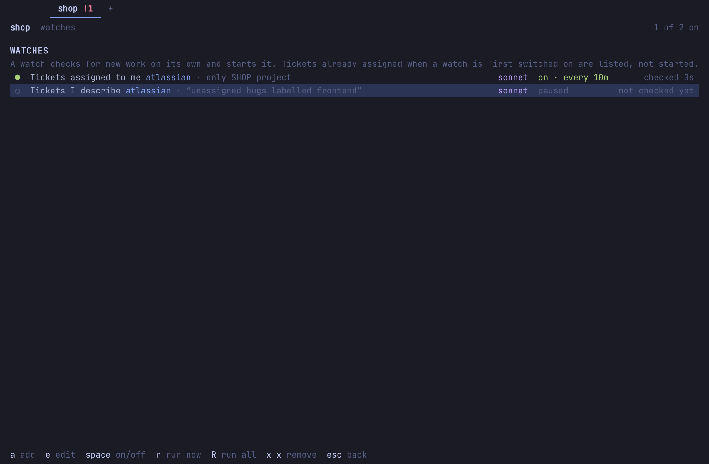
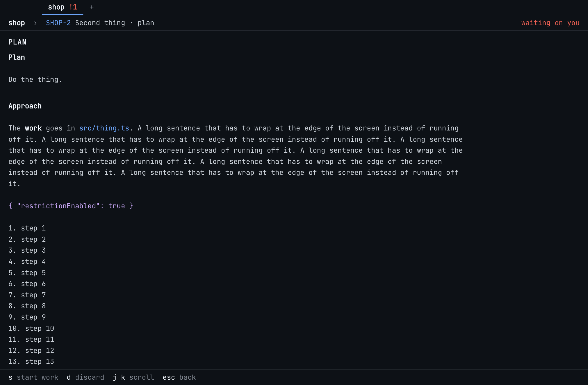
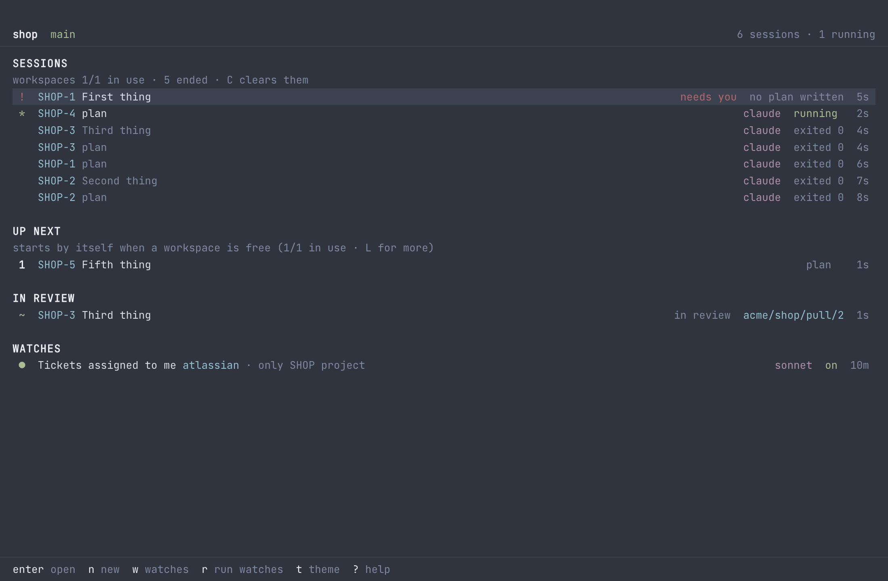
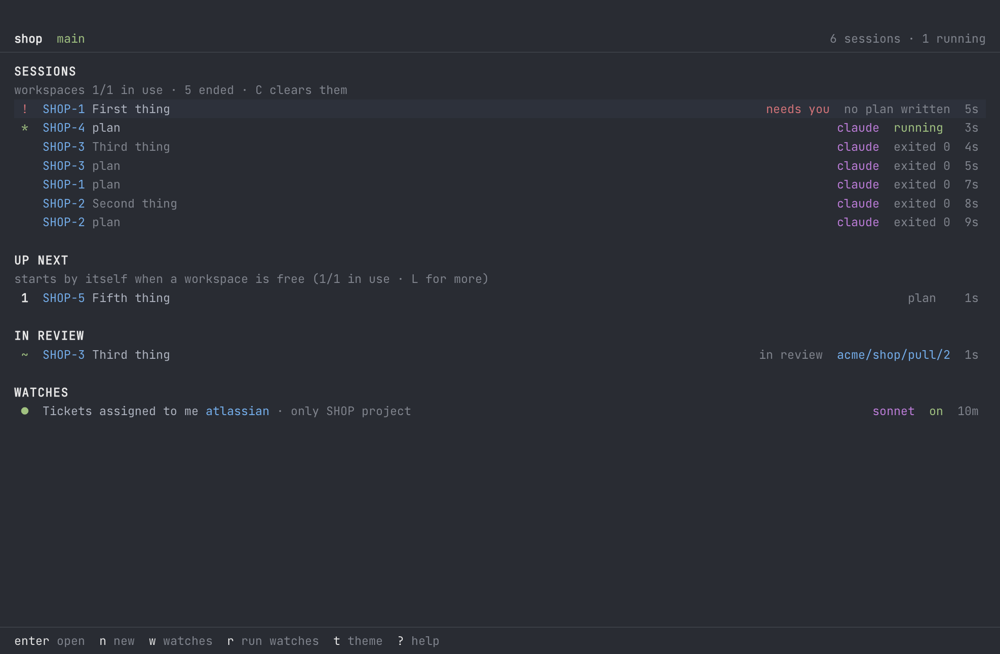
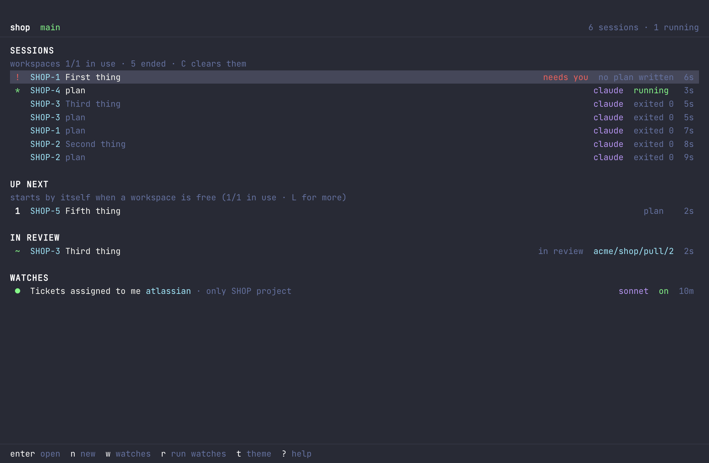
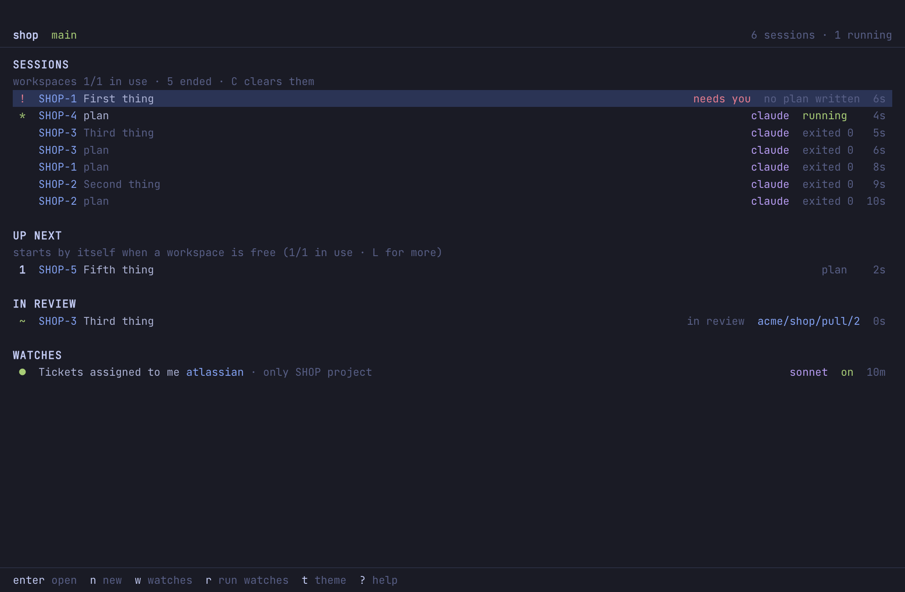

# Pitlane user guide

Pitlane is a macOS app that runs coding agents for you, one window per project. You can drive the agents yourself, or let Pitlane pick up work on its own: tickets assigned to you in Jira or Linear, and pull requests your teammates ask you to review. Every agent works in its own workspace on its own branch. Nothing it does touches your checkout, and nothing goes to a teammate without your approval.

This guide follows the order you meet things in.

- [1. First launch](#1-first-launch)
- [2. The home screen](#2-the-home-screen)
- [3. Sessions](#3-sessions)
- [4. Workspaces](#4-workspaces)
- [5. Watches](#5-watches)
- [6. How a ticket gets done](#6-how-a-ticket-gets-done)
- [7. Reviewing teammates' pull requests](#7-reviewing-teammates-pull-requests)
- [8. Live Changes](#8-live-changes)
- [9. Themes](#9-themes)
- [10. Updates](#10-updates)
- [11. All keys](#11-all-keys)
- [12. Troubleshooting](#12-troubleshooting)

---

## 1. First launch

Pitlane opens on a project picker. Choose **Open folder…** and pick a git repository. The project opens, and from then on every project you add is a tab at the top of the window, beside the traffic lights:

- **Switch** by clicking a tab, or with ⌘1 to ⌘9 for the first nine tabs. The window shows that project instead; nothing else opens.
- **See what waits on you elsewhere:** a tab shows `!2` when two things in that project wait on you (a ticket that needs you, a plan or review draft to read, an agent asking a question).
- **Add** a project with `+` at the end of the tabs, which asks for a folder (macOS asks once for access if it is on your Desktop or in Documents).
- Agents and watches keep running in the projects you are not looking at.

If you want two projects side by side, ⌘N opens the picker, and a project opened from there gets its own window.

What you need installed:

| For | You need |
|---|---|
| Any agent | [Claude Code](https://claude.com/claude-code) (`claude`) or Codex (`codex`) on your `PATH`, signed in |
| Ticket watches | A Jira (Atlassian) or Linear MCP server added to Claude Code, globally or for the project |
| Pull requests | [`gh`](https://cli.github.com) (GitHub) or [`glab`](https://gitlab.com/gitlab-org/cli) (GitLab), signed in |

Pitlane uses the project's own GitHub or GitLab account, read from `gh`/`glab`, and hands it to agents per command. It never switches the account your other terminals use.

## 2. The home screen

Everything about a project is on one screen, top to bottom:

1. **Needs you** (marked `!`): a ticket whose agent asked a question or stopped without a PR, and review drafts waiting for your approval. These are always at the top.
2. **Sessions**: every agent session, running first. Each row shows the ticket (if any), the agent, its state and its age. The line above says how many sessions have ended (`C` clears those).
3. **Up next**: tickets and reviews that will start by themselves, numbered in the order they will start. The line above says whether one is starting now or waiting for a workspace.
4. **Not started**: tickets that were already assigned to you when you switched a watch on, tickets already under way in the tracker (in progress, in review, in QA), tickets another project has already taken, plus review requests from people outside the repository's team. Each row shows the ticket's own tracker status. Pitlane never starts these by itself. They are folded into one line until you press `a`.
5. **In review**: tickets whose pull request is open, with a link to it (`p` opens it).
6. **Watches**: a summary of what Pitlane is watching. `w` opens the watch editor.

One cursor (`j`/`k` or the arrows) moves over every row on the screen, and `enter` does the obvious thing for the row it is on: opens a session, starts a ticket, opens a review draft or a pull request.

## 3. Sessions

Press `n` to start a session yourself and pick Claude or Codex. Pitlane opens the agent's **real terminal**: every key you type goes to the agent, including Esc (which interrupts Claude). Pitlane only keeps a few ⌘ shortcuts:

| Key | Does |
|---|---|
| `⌘↑` | back to the home screen; the agent keeps running |
| `⌘K` | the session switcher: type to filter, Enter to switch |
| `⌥⌘←` / `⌥⌘→` | previous / next session |
| `⌘D` | what this agent has changed (see [Live Changes](#8-live-changes)) |

Closing a window never stops its agents. Reopen the project and they are still there, with what they printed while you were away.

On the home screen:

- `s s` stops the selected session's agent. Its workspace and changes are kept. If it was working on a ticket, the ticket waits for you under *needs you*.
- `C` clears ended sessions from the list. A session whose workspace still holds unsaved work stays until you park it. Ended sessions also clear themselves a day after they end, and a done ticket lets go of its plan, so Pitlane's own data stays small. The workspaces are the only large thing: there is one per running agent, and when a session ends its workspace is cleaned and, unless it is the one clean workspace kept ready for the next session, removed from disk.
- `X` deletes the selected session at once, with no second press: a running agent is stopped first, the session leaves the list, and whatever its workspace kept, uncommitted or not, is thrown away.

When an agent asks something (Claude's notification hook), its row is marked `!`, it moves to the top, and macOS shows a notification. Typing an answer clears the mark.

## 4. Workspaces

Agents never run in your checkout. Each project has a small pool of **reusable workspaces**: git worktrees under `~/Library/Application Support/Pitlane/workspaces/`. A session switches a free workspace to its branch instead of cloning the project again, so there is no pile-up of copies.

- **How many agents at once:** as many as you start. Every ticket up next starts straight away, each in its own workspace.
- **Local files:** the first time you start an agent, Pitlane lists the git-ignored files at the project root (`.env`, `*.local.*`) and asks which to copy into workspaces. They are copied, never linked, and copied again only when your original changes.
- **Dependencies** are installed in a workspace when its lockfile changes.
- **Held workspaces:** when an agent ends with uncommitted work, its workspace is *held* rather than wiped, so nothing is lost. `x x` on that session *parks* it: the work is committed locally on its branch and the workspace is freed.

## 5. Watches

A watch checks for new work on its own and starts it. Press `w` on the home screen to open the watches.

There are two kinds:

| Watch | Looks at | How |
|---|---|---|
| **Tickets assigned to me** | Jira or Linear | Asks Claude (Sonnet by default) to list your open tickets through the tracker's MCP server, **read-only**: every tool except the tracker's audited read-only ones is refused |
| **Tickets I describe** | Jira or Linear | The same, read-only, but Claude looks for what you wrote in your own words (*unassigned bugs labelled frontend in the current sprint*) instead of your open tickets |
| **PRs that need my review** | GitHub or GitLab | `gh search prs --review-requested=@me` or `glab mr list --reviewer=@me` |

On the watches screen:

| Key | Does |
|---|---|
| `a` | add a watch: one per tracker server Claude knows for this project, a *Tickets I describe* watch for each (type what to look for, then enter), and the review watch |
| `e` / `enter` | edit the selected watch |
| `space` | switch it on or off |
| `r` | run the selected watch now instead of waiting for its interval; a paused watch runs once and stays paused |
| `R` | run every watch that is on now |
| `x x` | remove it (what it already found stays on the home screen) |
| `esc` | back home |

When editing (`↑↓` moves between fields, `←→` changes one):

- **tracker**: which Jira or Linear server to read, if Claude has more than one.
- **looks for**: your own words for which tickets to find; Enter to type, and an empty line goes back to *assigned to me and still open*. Tickets it finds go through the same plan-first flow, and each watch only ever drops or flags the tickets it found itself.
- **only from**: narrow the watch to one Jira project, Linear team or site, such as `SHOP project`. Needed whenever two projects watch the same tracker: without it, each gets every ticket assigned to you. Pitlane warns on both screens when two projects' watches would get the same tickets, and never lets two projects start the same ticket. A new ticket watch starts scoped to the keys the repository's branches and commits use (`SHOP`, `ADMIN or OPS`), and the editor shows that suggestion for an unscoped one: Enter on **only from** fills it in.
- **checks**: every 5, 10, 30 or 60 minutes.
- **model**: Sonnet, Haiku or Opus for reading the tracker.

**The first check only takes note.** When a watch is switched on for the first time, or after you change its tracker, what it looks for, or its scope, whatever is already assigned to you goes under *Not started* instead of starting: switching a watch on never starts ten agents at once. From then on, a ticket newly assigned to you goes to *Up next* and starts straight away, but only if the tracker files it under To Do (Jira's status category, Linear's backlog or unstarted). A ticket already in progress, in review or in QA is listed under *Not started*, and one that moves on while it waits leaves Up next by itself; one that is done drops off. Press `a` on the home screen to see the not-started tickets, and `enter` on one to put it up next. `x` on an Up next ticket takes it back out.

## 6. How a ticket gets done

**First, a plan.** A ticket assigned to you is planned before anyone writes code. A planning agent reads the ticket and the code at your trunk, in a workspace on no branch, and writes a plan with these sections: Understanding, Approach, Files, Tests, and Risks and questions. It changes nothing else. The plan appears at the top of the home screen as *plan ready*, and you get a notification.

Open it with `enter`:

| Key | Does |
|---|---|
| `s s` | start work: press twice |
| `d d` | discard the plan; the ticket goes back to *Not started*, and starting it again plans again |
| `j` / `k` | scroll |

**Then, the work.** When you start work, the project's lead agent (Claude by default) gets the ticket's full text, read from the tracker word for word and fenced as data, not instructions. It works on its own branch:

- named after the ticket, like `shop-12-fix-the-cart`, cut from your trunk and not tracking it;
- or, if a branch for the ticket key already exists on the remote, that branch, continued.

The workflow it is given:

1. Follow the approved plan, and say in the pull request if the code shows the plan was wrong.
2. Implement, following the project's conventions and its `CLAUDE.md` or `AGENTS.md`.
3. Run the tests, typecheck and lint, and fix what fails.
4. **Self-review:** a review subagent reads the diff against the ticket for bugs, missed requirements and leftover debugging, and the agent fixes what it finds.
5. Commit, push its branch, and open a pull request (or update the existing one).

Then Pitlane follows the pull request:

- **Opened**: the ticket moves to *In review* and the workspace is handed back.
- **Merged or closed**: the ticket is done.
- **Changes requested, new comments (inline or not), or failing CI**: the ticket goes back to *Up next* with no new plan, ahead of new tickets, and the agent gets the feedback with the same branch. Only feedback from the repository's owners, members and collaborators counts, never from bots or passers-by. After three rounds on the same pull request, a person is asked instead.
- **The agent stopped without a PR, or asked something**: the ticket is marked *needs you*, with the reason.
- **Unassigned from you**: marked *needs you*, and never started again on its own.

If Claude reports a usage limit, Pitlane pauses starting new work until the limit resets, and says so on the home screen.

## 7. Reviewing pull requests

With the review watch on, a pull request that asks for your review, **or one you opened yourself**, is reviewed **before** new tickets. Your own PRs on branches Pitlane's tickets worked on are skipped: those were reviewed before they were pushed. A review of your own PR can only be a comment, since nobody can approve or block their own PR. The review agent checks out the PR in a detached workspace and writes a draft review: a summary, a verdict (approve, comment or request changes), and comments on specific lines.

The draft appears at the top of the home screen as *review ready*. Open it with `enter`:

| Key | Does |
|---|---|
| `e` | edit the summary (`⌘↵` saves) |
| `v` | change the verdict |
| `x` | drop the comment under the cursor |
| `a a` | approve and post: press twice |
| `d d` | discard the draft |

**Nothing is posted until you press `a` twice.** Pitlane posts it, not the agent, and the review agent runs without your GitHub or GitLab token in the first place. A PR from someone outside the team is listed under *Not started* rather than reviewed by itself.

## 8. Live Changes

`⌘D` in a session, or `c` on the home screen, shows everything the agent has changed since it started, updated live.

| Key | Does |
|---|---|
| `j` / `↑↓` | next / previous file |
| `J` / `←→` | next / previous hunk |
| `k` | keep this file |
| `r` | revert this file |
| `R` | revert this hunk |
| `K` | keep everything |
| `X X` | revert everything |
| `esc` | back |

## 9. Themes

`t` cycles the project's theme; each project remembers its own. The agents' 16 terminal colours are mapped into each theme, so their output stays readable.

| | |
|---|---|
|  **GitHub Dark** (the default) |  **Nord** |
|  **Atom One Dark** |  **Dracula** |
|  **Tokyo Night** | |

A project whose theme was one of the earlier ones (VT220, Acme, Night City and the rest) opens in GitHub Dark.

## 10. Updates

Pitlane updates itself from this repository's [releases](https://github.com/braveson008/pitlane/releases).

- **On its own:** it checks when it starts and every six hours, and downloads a new version in the background.
- **When one is ready:** macOS shows a notification ("Pitlane 0.1.2 is ready"), and every window's status line says `0.1.2 ready · U restart to update`. Press `U` on a project's home screen, or click the note in a session's status line, to restart into it. If you don't, it installs the next time you quit.
- **By hand:** **Pitlane → Check for Updates…** tells you whether you are up to date, or that a new version is downloading. Once it has downloaded, the item reads **Restart to Update to 0.1.2**, and the dialog has a **What's New** button for the release notes. `U` on the home screen does the same check while nothing is ready.

Restarting stops running agents (you are asked first). Their workspaces, branches and changes are kept.

## 11. All keys

| Where | Keys |
|---|---|
| Home | `enter` open · `n` new session · `w` watches · `r` run watches now · `a` show/hide not started · `x` take out of up next · `s s` stop agent · `C` clear ended · `c` changes · `p` open PR · `x x` park held session · `X` delete session · `t` theme · `U` update · `?` help · `⌘K` switcher |
| Watches | `a` add · `e` edit · `space` on/off · `r` run now · `R` run all · `x x` remove · `esc` back |
| Session | everything goes to the agent · `⌘↑` home · `⌘K` switcher · `⌥⌘←/→` prev/next · `⌘D` changes |
| Changes | `k` keep · `r` revert · `R` revert hunk · `K` keep all · `X X` revert all · `j`/`J` files/hunks · `esc` back |
| Review draft | `a a` approve & post · `e` edit · `v` verdict · `x` drop comment · `d d` discard · `esc` back |
| Plan | `s s` start work · `d d` discard · `j`/`k` scroll · `esc` back |

## 12. Troubleshooting

- **The ticket watch says "no Jira or Linear MCP server for this project".** Add the Atlassian or Linear MCP server to Claude Code (`claude mcp add …`), for the project or globally, and sign in to it once in a normal `claude` session.
- **A watch shows `error`.** The message is under the watch. `r` checks again. A tracker that answers with prose instead of a list is treated as an error, never as "nothing assigned".
- **"no GitHub login" on a session.** The project's account is not signed in to `gh`. Run `gh auth login` for it; the agent still runs, but cannot push.
- **The folder moved.** The window offers *Locate…*; pick the new folder and everything (sessions, workspaces, Claude's MCP servers) follows it.
- **Did I miss an update?** Use **Pitlane → Check for Updates…**. If checking fails (offline, GitHub unreachable), the dialog says why; Pitlane tries again on its own later.
